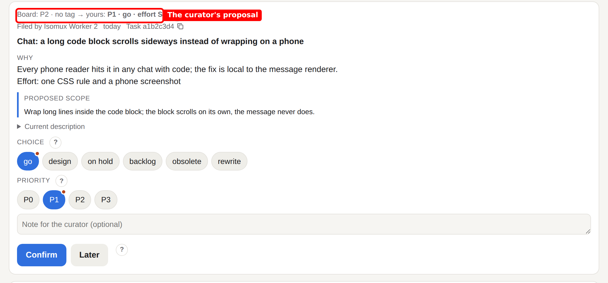
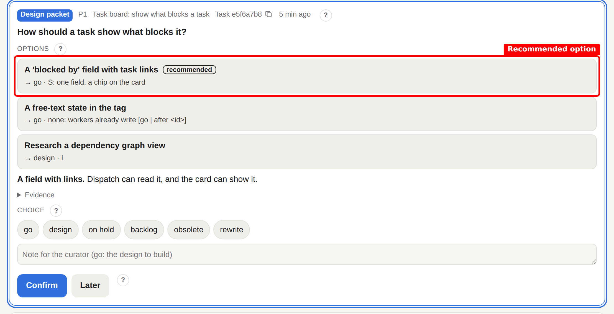
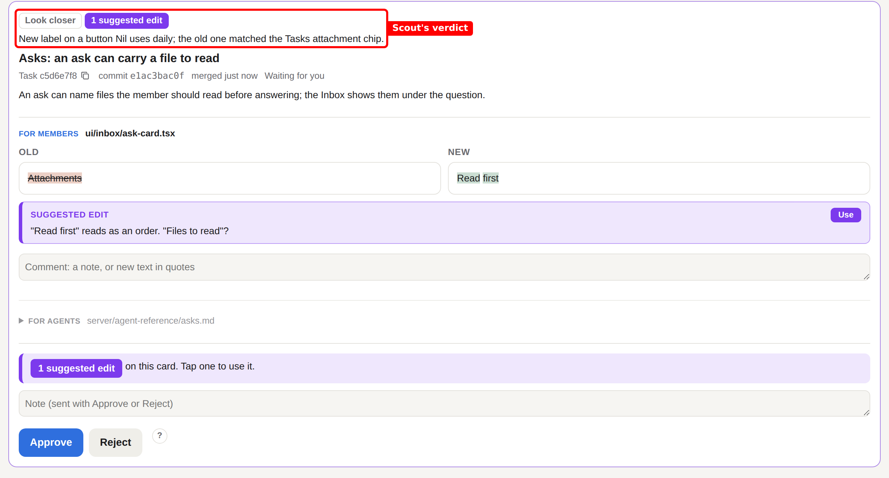
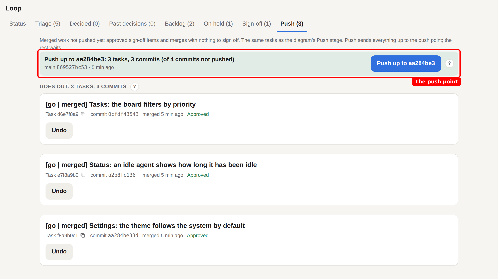
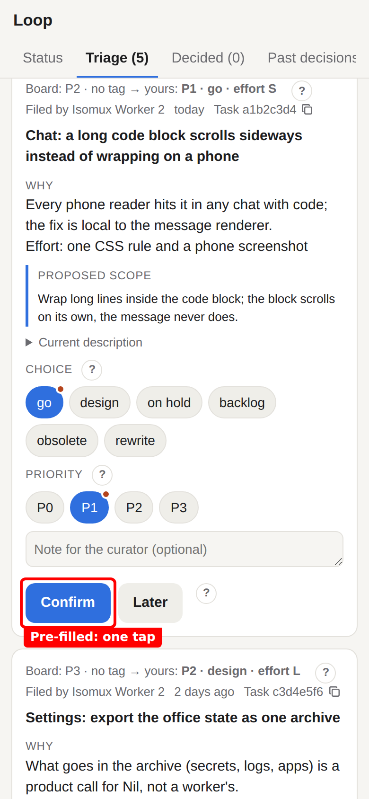
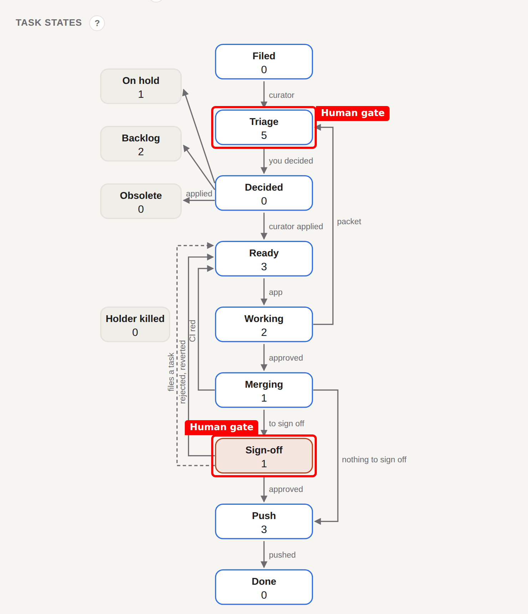

# Isomux loop app

A continuous loop for one repo, built on the ideas in my post [The end of agents](https://nilmamano.com/blog/end-of-agents). It dispatched board tasks to worker agents and brought me the decisions: triage, sign-off and push.

The decision pages have since moved into [Isomux](https://github.com/nmamano/isomux) itself, as asks in the Isomux Inbox. That part of this app is obsolete. What remains: dispatch and the hourly tick, the sign-off and push record that the agents report to, and a wake-up that tells the curator about new and changed tasks.

## What it did

- Triage. Each new board task came as a card with the curator's proposal: go, design, hold, backlog or obsolete, and a priority. One key to confirm.
- Dispatch. Ready tasks went to free worker agents, one task each; each worker had its own reviewer.
- Sign-off. Each merge came back as an item with its copy changes as a diff, its screenshots, and a scout's verdict: quick stamp, look closer or push back. I approved, commented or reverted.
- Push. A push went out only on my go, at the newest merge with every item up to it approved.

## Screenshots

Fake data, not real tasks.

## Running it

It runs as an app inside an Isomux office: `bun run start` (src/server.ts), with PORT, ISOMUX_APP_DATA_DIR and ISOMUX_APP_TOKEN set by the office. The decisions it used to show now live in the Isomux Inbox.
